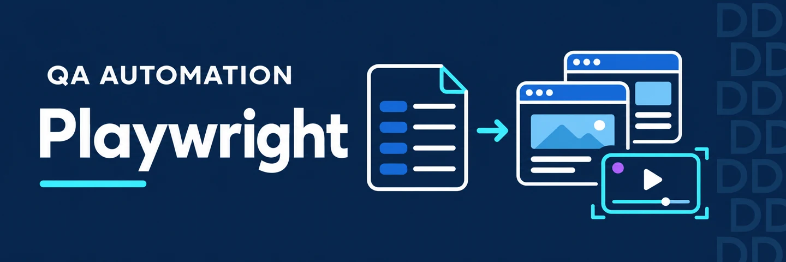
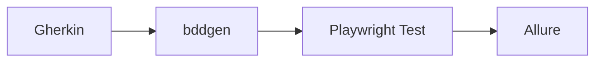

# Playwright + Cucumber + Allure

Pruebas web E2E en TypeScript con `playwright-bdd`. Los escenarios Gherkin se convierten en pruebas nativas de Playwright y sus resultados se reportan en Allure.

[Inicio rápido](#inicio-rápido) · [Flujo de prueba](#flujo-de-prueba) · [QA asistido por IA](#qa-asistido-por-ia) · [GitHub Actions](https://github.com/Jlaucel/TS-Playwrigth-Cucumber/actions/workflows/qa.yml)

## Qué incluye

- **Generación BDD.** `bddgen` traduce los archivos `.feature` a pruebas para Playwright Test.
- **Ejecución headless.** El ejemplo usa Chromium con la configuración del repositorio.
- **Evidencia.** Se generan capturas y se conserva el video cuando una prueba falla.

## Inicio rápido

Usa Node.js 24. Para abrir el reporte Allure, instala Java y configura `JAVA_HOME`.

```bash
npm ci
npx playwright install chromium
npm run qa:check
npm test
```

`npm test` genera los casos y ejecuta Playwright. Puedes enumerarlos con `npx bddgen` seguido de `npx playwright test --list`. Usa `npm run report` para abrir Allure.

## Flujo de prueba



El escenario `QA-PWA-001` comprueba la pantalla de tráfico inusual de Google. Tiene la etiqueta `@external` porque esa respuesta depende del servicio. CI valida Gherkin y enumera las pruebas generadas. [Ver los escenarios](features/google_search.feature)

| Ruta | Contenido |
| --- | --- |
| [`features/`](features/) | Escenarios Gherkin. |
| [`steps/`](steps/) | Definiciones de pasos en TypeScript. |
| [`playwright.config.ts`](playwright.config.ts) | Generación BDD, ejecución de navegador y reportes. |

## QA asistido por IA

| Skill de Codex | Cuándo usarla |
| --- | --- |
| [`$qa-design`](.agents/skills/qa-design/SKILL.md) | Diseñar escenarios BDD según criterios de aceptación y riesgo. |
| [`$qa-triage`](.agents/skills/qa-triage/SKILL.md) | Preparar un diagnóstico con los resultados y la evidencia de una ejecución. |
| [`$qa-integrations`](.agents/skills/qa-integrations/SKILL.md) | Relacionar diseños, criterios y casos con sus pruebas. |

`npm run qa:triage` resume los resultados Allure después de una ejecución. Los hooks de Codex orientan el flujo de diseño y diagnóstico. [Guía ISTQB y hooks](docs/qa.md)

Configura **Figma, Jira, Zephyr y Slack** en tu cliente local con acceso autorizado. [Guía de conexiones](docs/integraciones-qa.md)

---

**Colección QA Automation de Yunior Laucel**

[Cypress](https://github.com/Jlaucel/TS--Cypress-Cucumber) · **Playwright** · [WebdriverIO](https://github.com/Jlaucel/TS-WebdriverIO-Cucumber) · [Maestro](https://github.com/Jlaucel/TS-Maestro-Cucumber) · [yuniorlaucel.com](https://yuniorlaucel.com)
